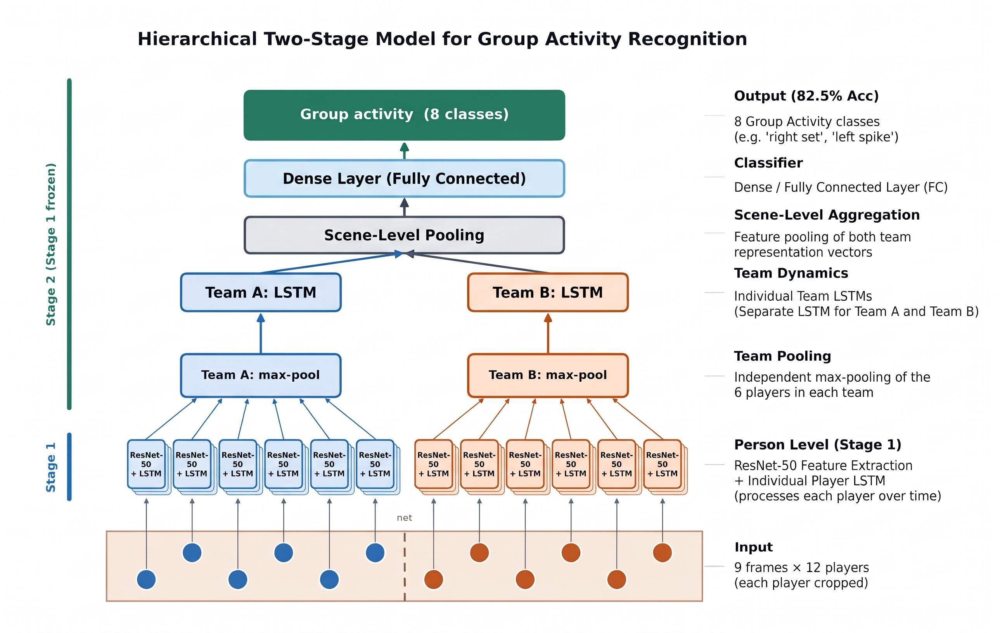
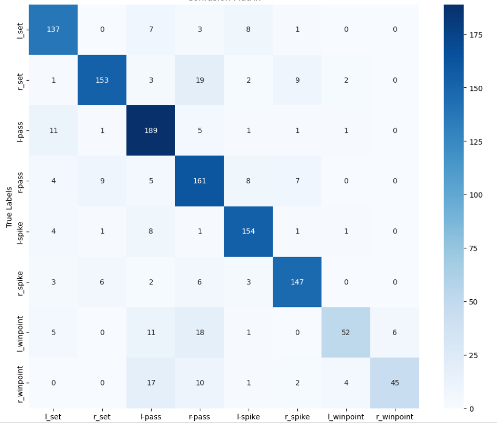

# Group Activity Recognition on the Volleyball Dataset

PyTorch implementation of a series of baselines (B1–B8) for recognizing **team activities** (e.g. *left spike*, *right set*) in volleyball videos, building up to a **hierarchical two-stage temporal model** (CNN → player-level LSTM → team-wise pooling → scene-level LSTM).

> **Course project** based on *Ibrahim et al., "A Hierarchical Deep Temporal Model for Group Activity Recognition", CVPR 2016*. The baseline definitions follow the course guidelines. This is a re-implementation for learning purposes, not the authors' code.

## Highlights

- 7 baselines implemented and compared on the same dataset (single frame → temporal → two-stage hierarchical).
- Best model (**B8**): **82.58 %** test accuracy on 8 group-activity classes, vs. 67.6 % for the single-frame baseline (B1).
- Video-level train/val/test splits (no frames from the same video appear in different splits).
- Class imbalance handled with class-weighted loss and down-sampling of the dominant "standing" class.
- Error analysis with confusion matrices (see below).

## Task and dataset

- **Dataset:** [Volleyball dataset](https://github.com/mostafa-saad/deep-activity-rec) (55 videos, 8 group-activity labels, 9 player-action labels, bounding boxes per player).
- **Group activities (8):** `l_set, r_set, l-pass, r-pass, l-spike, r_spike, l_winpoint, r_winpoint`.
- **Player actions (9):** waiting, setting, digging, falling, spiking, blocking, jumping, moving, standing.
- **Split (by video):**
  - train: 1 3 6 7 10 13 15 16 18 22 23 31 32 36 38 39 40 41 42 48 50 52 53 54
  - val: 0 2 8 12 17 19 24 26 27 28 30 33 46 49 51
  - test: 4 5 9 11 14 20 21 25 29 34 35 37 43 44 45 47
- Each sample is the target frame plus 4 frames before and 4 after it (9 frames in total).

The dataset is **not** included in this repository. Download it from the link above.

## Baselines

| ID | Description | Level |
|----|-------------|-------|
| B1 | ResNet-50 fine-tuned on the middle frame (image classification) | group |
| B3 | ResNet-50 fine-tuned on player crops (9 actions), then max-pooled player features → group classifier | group |
| B4 | Image-level features of the 9 frames → BiLSTM | group |
| B5 | Player-level temporal model: crop features over 9 frames → BiLSTM → action (stage 1 for B7/B8) | player |
| B6 | Max-pooled player features per frame → BiLSTM (no player-level LSTM) | group |
| B7 | **Two-stage model:** player-level BiLSTM → pool over all players → scene-level BiLSTM | group |
| B8 | **B7 with team-wise pooling:** players split into two teams, pooled separately, then concatenated | group |



## Results (test set, accuracy %)

| Baseline | Test acc. | Paper (Ibrahim et al.)\* |
|----------|----------:|-------------------------:|
| B1 – image classification | 67.6 | 66.7 |
| B3 – fine-tuned person classification | 63.9 | 68.1 |
| B4 – temporal model, image features | 72.7 | 63.1 |
| B6 – two-stage w/o player LSTM | 70.6 | 74.7 |
| B7 – two-stage (all-player pooling) | 75.5 | 80.2 |
| **B8 – two-stage + team-wise pooling** | **82.6** | 81.9 |

\* Reference numbers from the dataset's README. They are **not directly comparable** (different backbone and experimental setup). B5 is a player-level model, so it is not in this table.

### B8: per-class recall (test)

| Class | Recall |
|-------|-------:|
| l_set | 87.8 % |
| r_set | 81.0 % |
| l-pass | 90.4 % |
| r-pass | 83.0 % |
| l-spike | 90.6 % |
| r_spike | 88.0 % |
| l_winpoint | 55.9 % |
| r_winpoint | 57.0 % |



**Error analysis.** Six of the eight classes reach 81–91 % recall. The **win-point** classes are the weak spot (about 56–57 % recall): they are most often confused with *pass* classes (e.g. `r_winpoint` predicted as `l-pass` 17 times and as `r-pass` 10 times). They also have the fewest samples. A plausible explanation is that the moments around a point look similar to a pass in a 9-frame window, but this was not verified.

## Notes

- The best checkpoint of each model was selected on the validation set; the test set was only used for the final numbers.
- Training is staged (stage 1: person-level features, stage 2: group-level model), not end-to-end.

## Repository structure

```
.
├── baseline_1/   baseline_1.py, baseline_1_test.py
├── baseline_3/   baseline_3_s_1.py, baseline_3_s_2.py, baseline_3_test.py
├── baseline_4/   baseline_4.py, baseline_4_test.py
├── baseline_6/   baseline_6_s_1.py, baseline_6_s_2.py, baseline_6_test.py
├── baseline_7/   baseline_7_s_1.py, baseline_7_s_2.py, baseline_7_test.py
├── baseline_8/   baseline_8_s_1.py, baseline_8_s_2.py, baseline_8_test.py
├── assets/       model_diagram.png
├── results/      b8_confusion_matrix.png
└── requirements.txt
```

`_s_1` / `_s_2` are stage 1 (player-level) and stage 2 (group-level) training scripts. `_test.py` evaluates the best saved checkpoint.

## How to run

1. Download the dataset and install the requirements:
   ```bash
   pip install -r requirements.txt
   ```
2. Edit the dataset and checkpoint paths at the top of each script (they are currently set for a Kaggle environment, `/kaggle/input/...`).
3. Run the scripts of a baseline in order, for example for B8:
   ```bash
   python baseline_8/baseline_8_s_1.py     # stage 1: player-level model
   python baseline_8/baseline_8_s_2.py     # stage 2: group-level model
   python baseline_8/baseline_8_test.py    # evaluation on the test videos
   ```
   B6 reuses the stage-1 weights of B3.

A GPU is required in practice (ResNet-50 on 9 frames × up to 12 players per clip).

## References

- M. Ibrahim, S. Muralidharan, Z. Deng, A. Vahdat, G. Mori. *A Hierarchical Deep Temporal Model for Group Activity Recognition.* CVPR 2016.
- Dataset and original code: <https://github.com/mostafa-saad/deep-activity-rec>

## Author

Ziad Abdallah Jamil Hamed · [GitHub](https://github.com/ziadabdallah047-glitch) · [LinkedIn](https://www.linkedin.com/in/ziad-abdallah-6b9332333)
